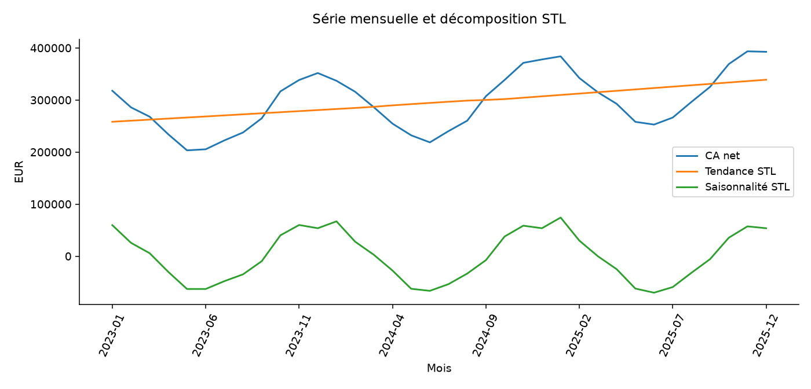

# LudiStore — fidélité et prévision des ventes de jeux

Déterminer si la croissance provient du nombre de commandes, du panier ou de la fidélité, puis recommander une prévision comparée à une référence simple.

## Mon approche

Je contrôle la qualité des données et les clés avant de calculer les indicateurs. Je compare les résultats, explicite les hypothèses et propose des actions à vérifier avec le métier. Ce projet utilise des données synthétiques et ne correspond à aucune mission réelle.

## Méthodes

- Réconciliation des ventes, agrégats annuels et catégorie, commandes partielles et profils RFM.
- Cohortes avec censure à droite, rétention pondérée, comparaison particuliers/professionnels.
- Spearman, Kruskal et taille d’effet ; interprétation contextualisée des résultats.
- STL descriptive, apprentissage sur 30 mois, test sur six mois, ETS versus naïf saisonnier et analyse des résidus.

## Livrables

- [Notebook Jupyter](notebooks/analyse.ipynb) : calculs exécutés, graphiques et analyse détaillée.
- [Rapport PowerPoint](presentation/soutenance.pptx) : présentation modifiable.
- [Rapport PDF](presentation/soutenance.pdf) : version de lecture.
- [Synthèse des résultats](analysis/SYNTHESE.md).
- `data/` et `analysis/` : sources, tables nettoyées et résultats au format CSV.

## Reproduire l’analyse

Installer Python 3.12 et les dépendances avec `python -m pip install -r requirements.txt`. Ouvrir le notebook dans Jupyter ou VS Code, choisir le noyau Python installé et exécuter toutes les cellules dans l’ordre. La graine de simulation est fixe. Les sources sont régénérées à l’exécution ; ne pas remplacer ces CSV par des données réelles sans adapter le chargement.

La dernière cellule recrée le PowerPoint. Pour actualiser le PDF après modification, ouvrir la présentation dans PowerPoint ou LibreOffice Impress puis l’exporter en PDF. Les graphiques sont des images et les textes restent modifiables.

Les données fictives, les méthodes et les limites sont détaillées dans le notebook. Les résultats ne constituent pas une performance démontrée en situation réelle.

## Aperçu

## Quelques repères

Ces valeurs décrivent le jeu synthétique utilisé dans ce projet.

| Indicateur | Valeur |
|---|---:|
| transactions | 179 930 |
| commandes | 89 965 |
| ca net | 10 671 885,2100 |
| spearman age ca | 0,0064 |
